

 

### Support fl_chart 💙
I've been building and maintaining fl_chart for free since 2019, in my spare time. These days I also make games. If fl_chart has saved you some time, the nicest way to say thanks is to play one of them for a minute. It costs you nothing and it means a lot to me. 💙

<table>
  <tr>
    <td width="140"></td>
    <td>
      <b>Save the Potato</b> 
      Keep the orbs away so the potato can enjoy its music in peace. 
      <a href="https://savethepotato.com/get/?utm_source=fl_chart&utm_medium=readme">▶ Play it now</a>
    </td>
  </tr>
  <tr>
    <td width="140"><a href="https://play.google.com/store/apps/details?id=dev.app2pack.ttg&utm_source=fl_chart&utm_medium=readme">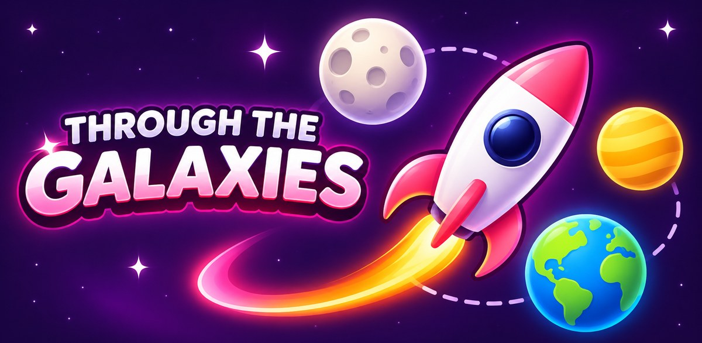</a></td>
    <td>
      <b>TTG - Through The Galaxies</b> 
      Fly your rocket from planet to planet and see how far into space you can go. 
      ▶ <a href="https://play.google.com/store/apps/details?id=dev.app2pack.ttg&utm_source=fl_chart&utm_medium=readme">Android</a> · <a href="https://apps.apple.com/app/id6444870791">iOS</a>
    </td>
  </tr>
</table>

📬 Want to hear about my next game? [Join my mailing list](https://iman-khoshabi.kit.com/profile). Only a few emails a year, no spam.

### Overview
FL Chart is a highly customizable Flutter chart library that supports **[Line Chart](https://app.flchart.dev/#/line)**, **[Bar Chart](https://app.flchart.dev/#/bar)**, **[Pie Chart](https://app.flchart.dev/#/pie)**, **[Scatter Chart](https://app.flchart.dev/#/scatter)**, and **[Radar Chart](https://app.flchart.dev/#/radar)**.

<a href="https://www.youtube.com/watch?v=hVRU-kpKNjQ&list=PL1-_rCwRcnbNpvodmbt43O81wMUdBv8-a">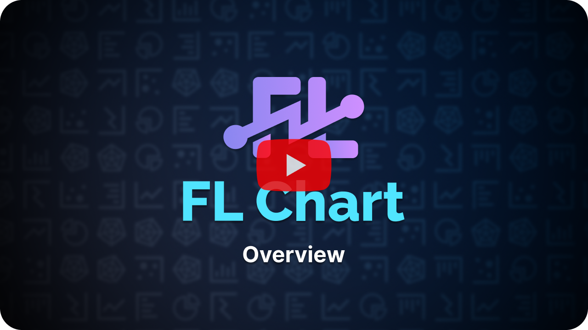
</a>

### Chart Types

|LineChart	|BarChart		|PieChart		|
|:------------:|:------------:|:-------------:|
|	[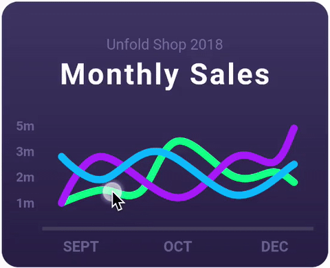](https://flchart.dev/docs/line-chart#sample-1-source-code) [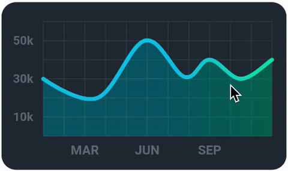](https://flchart.dev/docs/line-chart#sample-2-source-code)  |	[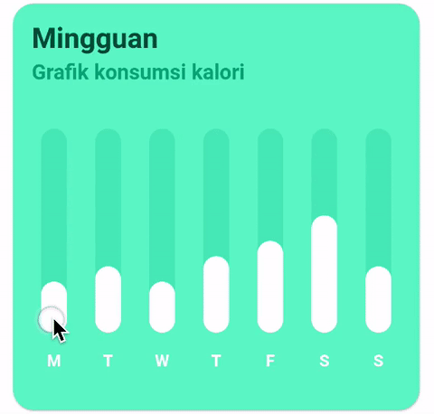](https://flchart.dev/docs/bar-chart#sample-1-source-code) [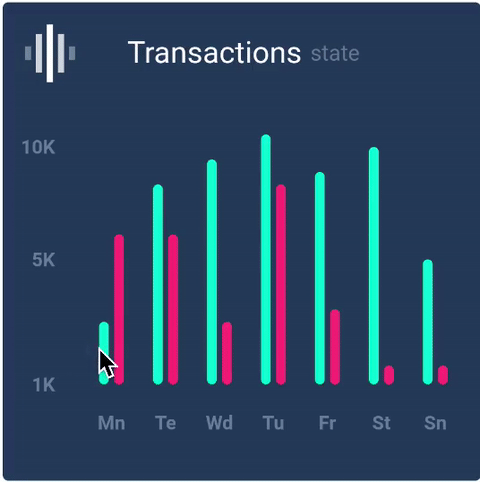](https://flchart.dev/docs/bar-chart#sample-2-source-code)  | [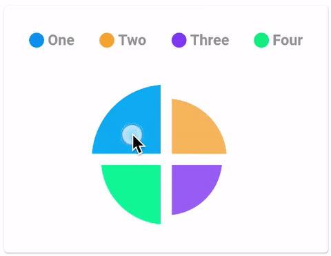](https://flchart.dev/docs/pie-chart#sample-1-source-code) [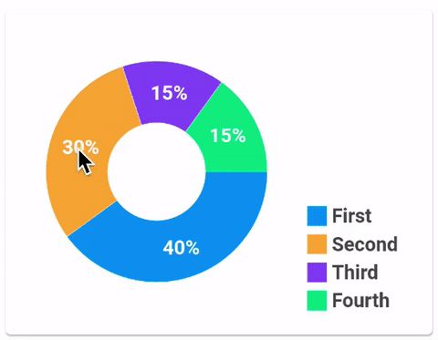](https://flchart.dev/docs/pie-chart#sample-2-source-code) |
|[Read More](https://flchart.dev/docs/line-chart)|[Read More](https://flchart.dev/docs/bar-chart)|[Read More](https://flchart.dev/docs/pie-chart)|

|ScatterChart	|RadarChart| CandlestickChart|
|:------------:|:------------:|:-------------:|
|	[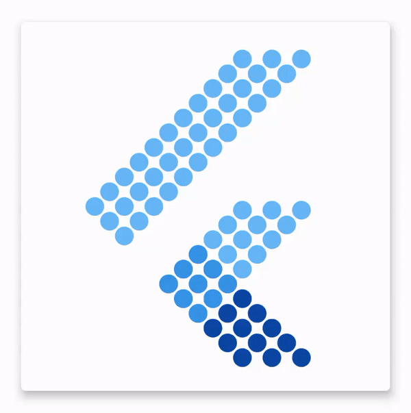](https://flchart.dev/docs/scatter-chart#sample-1-source-code) [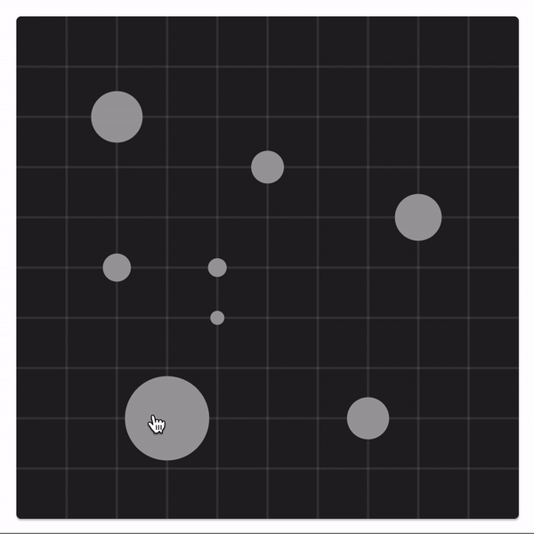](https://flchart.dev/docs/scatter-chart#sample-2-source-code)  |	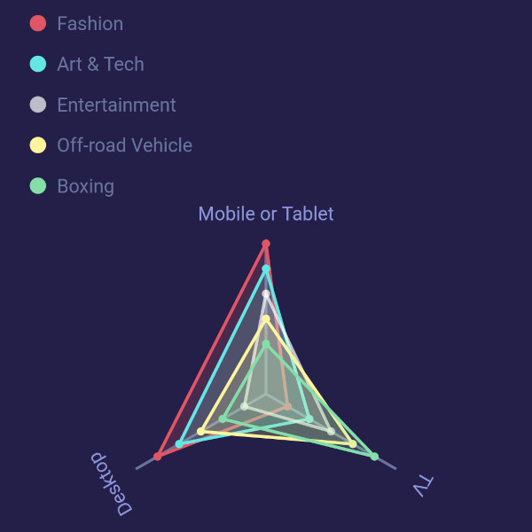  |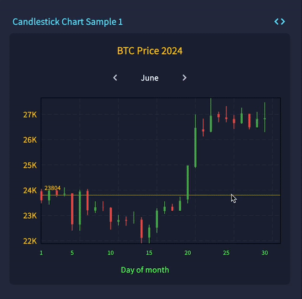 |
|[Read More](https://flchart.dev/docs/scatter-chart)|[Read More](https://flchart.dev/docs/radar-chart)|[Read More](https://flchart.dev/docs/candlestick-chart)|

Banner designed by [Soheil Saffar](https://www.linkedin.com/in/soheilsaffar), and
samples inspired from
[David Kovalev](https://dribbble.com/shots/5560237-Live-Graphs-XD),
[Ricardo Salazar](https://dribbble.com/shots/1956890-Data-Stats),
[Dmitro Petrenko](https://dribbble.com/shots/5425378-Mobile-Application-Dashboard-for-Stock-Platform),
[Ghani Pradita](https://dribbble.com/shots/6379476-Calories-Management-App),
[MONUiXD](https://www.uplabs.com/posts/chart-pie-chart-bar-chart).
Thank you all!

# Let's get started

First of all, you need to add the `fl_chart` in your project. To do that, follow [this guide](https://pub.dev/packages/fl_chart/install).

Then you need to read the docs. Start from [here](https://flchart.dev/docs).

We suggest that you check the sample source code.

##### - You can read about the animation handling [here](https://flchart.dev/docs/handle-animations)
|Sample1	|Sample2		|Sample3		|
|:------------:|:------------:|:-------------:|
|	[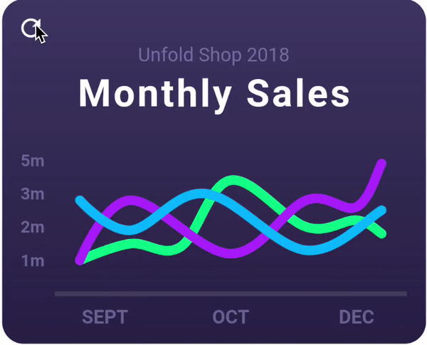](https://flchart.dev/docs/line-chart#sample-1-source-code)   |	[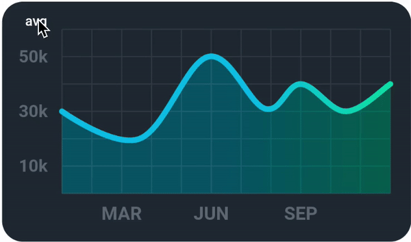](https://flchart.dev/docs/line-chart#sample-2-source-code) | [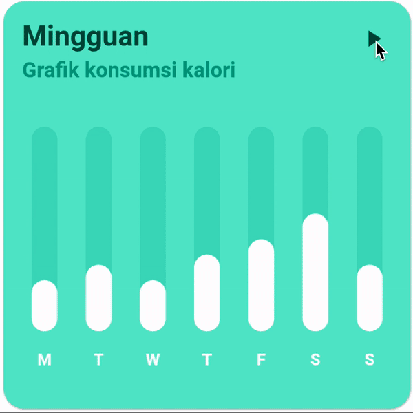](https://flchart.dev/docs/bar-chart#sample-1-source-code) |

### Try it out
You can try the FL Chart sample app on the platforms that are available below:

[//]: # ([![Download for macOS]&#40;https://img.shields.io/badge/Download-for%20macOS-darkblue?style=for-the-badge&logo=apple&logoColor=white&#41;]&#40;https://apps.apple.com/app/your-macos-app-id&#41;)
[//]: # ([![Download for Linux]&#40;https://img.shields.io/badge/Download-for%20Linux-orange?style=for-the-badge&logo=linux&logoColor=white&#41;]&#40;https://your-linux-distribution-link.com&#41;)
[//]: # ([![Download for Windows]&#40;https://img.shields.io/badge/Download-for%20Windows-blue?style=for-the-badge&logo=windows&logoColor=white&#41;]&#40;https://your-windows-app-link.com&#41;)

### Donation
Your donation motivates me to work more on the fl_chart and resolve more issues.
There are multiple ways to donate to me:

1. You can be my sponsor on [GitHub](https://github.com/sponsors/imaNNeo) (This is the most reliable way to donate to me)
2. You can <a href="https://www.buymeacoffee.com/fl_chart">buy me a coffee!</a>
3. Or if you are a fan of crypto, you can donate me Bitcoins here: `1L7ghKdcmgydmUJAnmYmMaiVjT1LoP4a45`

### Contributing
##### :beer: Pull requests are welcome!
Remember that open-source projects thrive on contributions. Every improvement—no matter how small—makes a meaningful difference, even if it’s just a single line.

Our documentation may contain grammatical issues, and if you’re fluent in English, your help in correcting them would be greatly appreciated.

Check out [CONTRIBUTING.md](https://github.com/imaNNeo/fl_chart/blob/main/CONTRIBUTING.md), which contains a guide for those who want to contribute to the FL Chart.

Reporting bugs and issues is also a contribution, yes, it is.

#### Below are the people who have contributed to the FL Chart. We hope we have your picture here soon.

